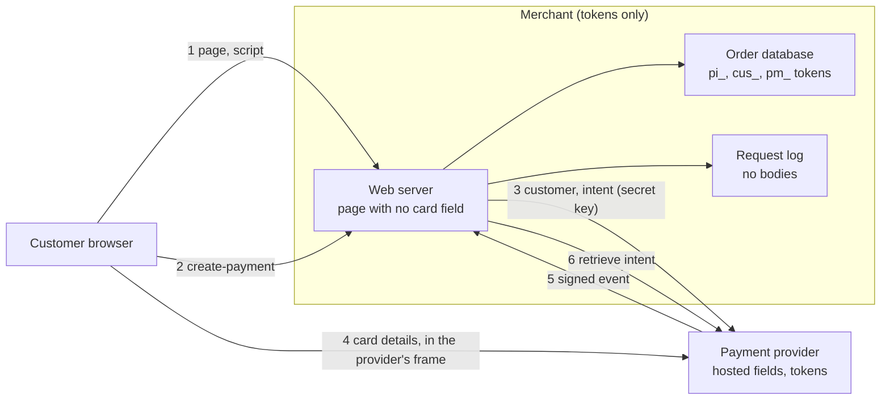

# Architecture: keeping card data out of the merchant

Component names match the lesson's diagrams: **Customer browser**, **Web server**, **Request log**, **Log search tool**, **Order database**, **Backups**, **CI/CD pipeline** for the "before" (the cardholder data environment), and **Hosted fields**, **Token only**, **Charge**, **Prove it**, **Redraw scope**, **Evidence** for the redesign.

## Components and what each owns

| Component | Where it lives | What it owns |
| --- | --- | --- |
| **Web server (naive)** | [interfaces/naive_app.py](src/pci_scope/interfaces/naive_app.py) | The lesson's `naive.py`: a form that posts card details to your own server, and a log line that writes the whole form. It exists to be measured. |
| **Hosted fields** | [interfaces/provider_app.py](src/pci_scope/interfaces/provider_app.py) (`/v1/elements.js`, `/frame`) | The script and the iframe the provider serves, so the card is typed into the provider's origin. |
| **Token only** (merchant) | [interfaces/merchant_app.py](src/pci_scope/interfaces/merchant_app.py), [application/checkout.py](src/pci_scope/application/checkout.py) | The page with no card field, `create-payment`, `done`, `charge-again`, `refund`, `webhook`. It stores and logs tokens. There is no route that takes a card. |
| **Charge** | `HttpProvider` in [infrastructure/provider_http.py](src/pci_scope/infrastructure/provider_http.py) | The server-side calls with the secret key: customers, intents, retrieve, off-session charge, refund. Timeouts and retries on every call. |
| **Prove it** | [domain/card.py](src/pci_scope/domain/card.py), [domain/har.py](src/pci_scope/domain/har.py), [application/proof.py](src/pci_scope/application/proof.py), [interfaces/browser_sim.py](src/pci_scope/interfaces/browser_sim.py) | The scanner (Luhn plus card-field names), the capture (a HAR from a scripted browser) and the checks on it. |
| **Redraw scope** | [domain/scope.py](src/pci_scope/domain/scope.py), [scope/](scope) | The computation of what is in scope and why, and the diagrams. |
| **Evidence** | [domain/evidence.py](src/pci_scope/domain/evidence.py), [controls/requirements.toml](controls/requirements.toml), [infrastructure/evidence_store.py](src/pci_scope/infrastructure/evidence_store.py) | Seven requirements, their files, the manifest of hashes and the content checks. |
| **The scenario** | [interfaces/demo.py](src/pci_scope/interfaces/demo.py) | Starts the three apps on local ports, runs both checkouts, a repeat charge, a refund and a route probe, scans, and writes the pack. |

## Pattern: ports and adapters around the payment provider

The checkout use case depends on two ports, `PaymentProvider` and `OrderRepository`. `HttpProvider` and `SqliteOrders` implement them; tests use a fake provider and a dict. The provider is the one boundary that matters for scope, so it is the one that is a port: swapping the local stand-in for a real provider's test mode changes an environment variable, not the code. The proof is built the same way: the scan reads through an `ArtifactReader`, so it can scan files, a database dump or a folder with one function.

## Data flow

### One run, step by step (`make run`)

1. The scenario clears `state/` and `evidence/`, creates the order table from `sql/001_schema.sql`, and starts the provider, the merchant and the naive app on the ports in `.env`.
2. **Before:** the scripted browser posts the test card to the naive `/pay`. The naive app logs the form. The scanner reads that log: 3 findings, exit 1.
3. **After:** the browser loads the merchant's page (no card field, a policy naming only the provider), the provider's script, asks the merchant for a payment (the merchant creates a customer and an intent with the provider and answers with the client secret), loads the provider's card frame, and sends the card to the provider to make a payment method and confirm the intent.
4. The provider sends a signed event to the merchant's `/webhook`. The browser returns to `/done?payment_intent=...`; the merchant asks the provider for the intent's real status (it does not trust the browser) and records it with the payment-method token.
5. A repeat charge: `/charge-again` sends the provider only the customer and payment-method tokens. A refund: `/refund` sends only the intent token. Two probes check `POST /pay` and `GET /pay` answer 404.
6. The merchant's log, the database (as SQL text) and a backup are scanned: 0 findings. The lesson's two `grep` commands run on the same places and exit 1 (nothing found).
7. The scope documents are computed from `scope/before.toml` and `scope/after.toml`. The HAR (provider-bound bodies redacted, field names kept), its summary, the route check, the token storage, the page controls and the two authored documents are written to `evidence/` with hashes, and `INDEX.md` is built.
8. `verify` checks the pack against `controls/requirements.toml`.

## Decisions and trade-offs

- **Hosted fields from a stand-in provider (ADR 0001).** The lesson names a provider's test mode, which needs an account and a network. A local stand-in with the same API shape lets the whole scenario run and be tested offline; the cost is that the provider side is not the real thing and the README says so.
- **The merchant asks the provider for the status (ADR 0002).** The browser comes back with `?payment_intent=pi_...`; trusting it would let anyone mark an order paid. `complete` always retrieves the intent from the provider.
- **The price is on the server.** `create-payment` takes no amount from the request.
- **Scope is a computation.** Hand-drawn diagrams drift. Card data spreads along `data` edges from the systems it touches; the page host is in scope for page integrity; anything that can change an in-scope system is in scope (ADR 0003). The reports are generated, and a test pins the lesson's numbers.
- **A scan with masked evidence.** A report that quotes the card number is a new copy of the card. Findings show the first six and last four digits only.
- **The proof is recomputed.** `verify` reads the HAR and checks the merchant-bound requests itself rather than trusting `payment-summary.txt`; the summary is for people.
- **grep with `-a`.** The lesson's `grep -rIn` skips binary files, and SQLite files are binary, so the database is never searched. The scenario uses `-a` and also scans the database as SQL text.
- **No access logs in the demo servers.** A URL is a place data can land (`/done?card=...`); the local servers do not write one.
- **The CHECK constraints.** `payment_method_id GLOB 'pm_*'` is cheap and makes the schema itself a control.

## Failure modes the lesson teaches, and how the code shows them

| Mistake (lesson, "Common mistakes") | How it shows here |
| --- | --- |
| Keeping the old route alive | `route-check.txt` and the unit test pin `POST /pay` and `GET /pay` at 404. |
| Logging whole request bodies | The merchant logs events, never bodies (a test checks `caplog`); the naive app is the counter-example the scan flags. |
| Testing with one grep only | The scanner handles grouped, dashed and URL-encoded forms; the lesson's grep is run too. |
| Declaring the web server out of scope | `scope-after.md` keeps it in scope, with the reason. |
| Saving the card "temporarily" | There is no column, field or route for it; the schema rejects a number in a token column. |
| Using a real card or a live key | Settings refuse a key that is not `sk_test_` and `pk_test_`. |

## Limits of the teaching build against a production one

- The provider is a stand-in with in-memory state; a real one is a separate, audited service.
- The scripted browser does not run JavaScript, so a break in `checkout.js` or the provider's script would not be seen by the tests (README, simplified for teaching).
- A real assessment depends on the merchant level and the integration type (the questionnaire for a fully outsourced page differs from one for a page that handles card fields); this repository stops at the evidence and names that as the owner's next step.
- Page integrity beyond a content security policy (script allow-listing and change detection on the payment page) is listed in `responsibilities.md`, not built.
- Tokens are stored in clear in a SQLite file; a production store encrypts them at rest.

## How to extend it

Point `PROVIDER_BASE_URL`, `PROVIDER_PUBLIC_URL` and the keys at a real provider's test mode and run `make test-e2e` with the provider server removed from the scenario. Add a requirement: a `[[requirement]]` in `controls/requirements.toml` with its evidence files and a content check in `domain/evidence.py`. Add a system to the scope: a `[[system]]` and its edges in `scope/*.toml`; the test that pins 9 and 3 will say the numbers changed.
