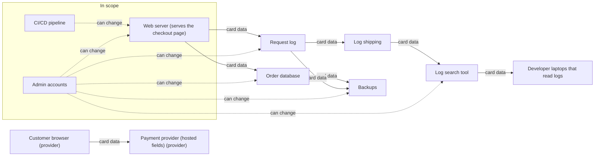

# After: the card number goes from the browser to the provider

**3 systems and 2 teams in scope** (developers, operations).

| System | Team | Why it is in scope |
| --- | --- | --- |
| Web server (serves the checkout page) | developers | serves the page that loads the provider's script |
| CI/CD pipeline | developers | can change Web server (serves the checkout page) |
| Admin accounts | operations | can change Web server (serves the checkout page) |

Out of scope: Request log, Log shipping, Log search tool, Order database, Backups, Developer laptops that read logs.
