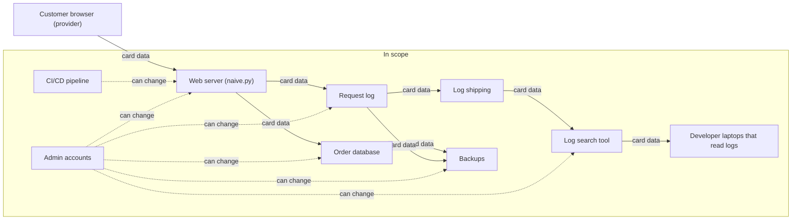

# Before: the card number reaches the merchant's server

**9 systems and 3 teams in scope** (developers, operations, support).

| System | Team | Why it is in scope |
| --- | --- | --- |
| Web server (naive.py) | developers | card data reaches it |
| Request log | operations | card data reaches it from Web server (naive.py) |
| Log shipping | operations | card data reaches it from Request log |
| Log search tool | support | card data reaches it from Log shipping |
| Order database | developers | card data reaches it from Web server (naive.py) |
| Backups | operations | card data reaches it from Order database |
| CI/CD pipeline | developers | can change Web server (naive.py) |
| Admin accounts | operations | can change Web server (naive.py) |
| Developer laptops that read logs | developers | card data reaches it from Log search tool |

Out of scope: none.
